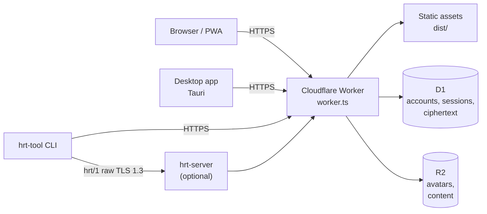

# Architecture

The tracker is one Cloudflare Worker that serves the web app and every
`/api/*` route. The same Worker sources run in the Docker image under
Wrangler's local runtime. A separate, optional Node process speaks the raw
`hrt/1` protocol for the CLI. The browser and the CLI hold the plaintext;
the server holds encrypted payloads and the metadata needed to route them.

## Diagram



Plain-text map, for readers who cannot render Mermaid:

```
Browser / PWA ──HTTPS──┐
Desktop (Tauri) ───────┼──> Worker (worker.ts) ──> D1 (metadata + ciphertext)
hrt-tool (HTTPS) ──────┘         │
hrt-tool (raw hrt/1) ──> hrt-server ──> Worker
                                  └──> R2 (avatars, content)
```

The diagram is conceptual. It shows the pieces and the direction of trust, not
a particular deployment.

## Components

| Component      | Location                                                                | Responsibility                                                                           |
| -------------- | ----------------------------------------------------------------------- | ---------------------------------------------------------------------------------------- |
| Web app        | `src/` (React 18, Vite 6, TypeScript)                                   | Dose/lab/weight UI, model, local storage, client-side encryption                         |
| Worker         | `worker.ts`, `toolApi.ts`, `contentStore.ts`, `hrtPairing.ts`, `f2f.ts` | Static assets, `/api/*`, auth, rate limits, D1/R2 access                                 |
| Database       | D1 (`hrt-tracker-prod`)                                                 | Accounts, sessions, login backoff, encrypted backups, share rows, passkeys, 2FA, notices |
| Object storage | R2 (`AVATAR_BUCKET`)                                                    | Avatars and retained content objects                                                     |
| Raw transport  | `hrt-server/` (Node 22)                                                 | Optional TLS 1.3 adapter for `hrt/1`; disabled by default                                |
| Desktop        | `src-tauri/` (Tauri 1.8)                                                | Wraps the web app; points at a server with `VITE_API_ORIGIN`                             |
| CLI            | `tools/hrt-tool`, `tools/hrt-cold`, `tools/hrt-f2f`                     | Terminal client, offline cold backup, F2F keyrings                                       |

## Request flow

1. The browser loads the built app from the Worker's `ASSETS` binding.
2. API calls go to `/api/*` with a Bearer token (web session, tool session, or
   an F2F-scoped token). The Worker validates the token, applies rate limits,
   and scopes database access by `user_id`.
3. Dose, lab, and weight records stay in the browser by default. Backups,
   share snapshots, and live-share updates are encrypted in the browser before
   they are sent; the Worker stores the envelope.
4. Admin routes require the admin role from the environment-configured admin
   account. There is no user promote-to-admin route.
5. If `HRT_RAW_ENABLED=1`, the `hrt-server` process accepts the raw `hrt/1`
   protocol, verifies device signatures, and forwards allowlisted
   `/api/tool/v1/*` calls to the Worker over loopback.

## Trust boundaries

| Boundary                     | What crosses it                                        | What the other side learns                      |
| ---------------------------- | ------------------------------------------------------ | ----------------------------------------------- |
| Browser → Worker             | Encrypted backups/shares, account and session metadata | Ciphertext, sizes, timestamps, account identity |
| Browser → Worker (plaintext) | Login, registration, profile, admin actions            | Credentials in transit (HTTPS), profile fields  |
| CLI → Worker                 | Bearer token, encrypted snapshots, F2F material        | Token identity, request metadata                |
| CLI → `hrt-server`           | `hrt/1` frames signed by a device key                  | Device identity, request metadata               |
| Operator → host              | `.dev.vars`, D1/R2 data, volume backups                | Everything the server stores                    |

The browser and the CLI hold the keys. The server does not receive the
passphrase or the plaintext snapshot. See [Security](Security) for the
operational consequences.

## Chapters

- **UI and model:** `src/pages`, `src/services`, `src/hooks`; the model and
  calibration live in the browser.
- **API:** `worker.ts` route groups: public, authenticated user, admin, shares,
  content, tool, F2F.
- **Storage:** D1 migrations `migrations/0000`–`0012`; R2 avatar/content
  objects.
- **Raw transport:** `hrt-server/`, ALPN `hrt/1`, four-byte big-endian length
  plus JSON frames.
- **CLI:** `tools/` (see the Tools wiki).
- **Deployments:** [Deployment](Deployment) compares Cloudflare, Docker, VPS,
  and local development.

## Canonical sources

- `README.md` — user-facing feature and self-hosting overview.
- `worker.ts` — HTTP routes, auth, rate limits, D1/R2 access.
- `toolApi.ts` — tool-scoped snapshot and version endpoints.
- `hrt-server/` — raw TLS adapter and pairing.
- `migrations/` — schema history.
- `src/services/` — client-side crypto, sharing, backup, and API client.
- `docs/superpowers/specs/` — design notes for larger changes.
